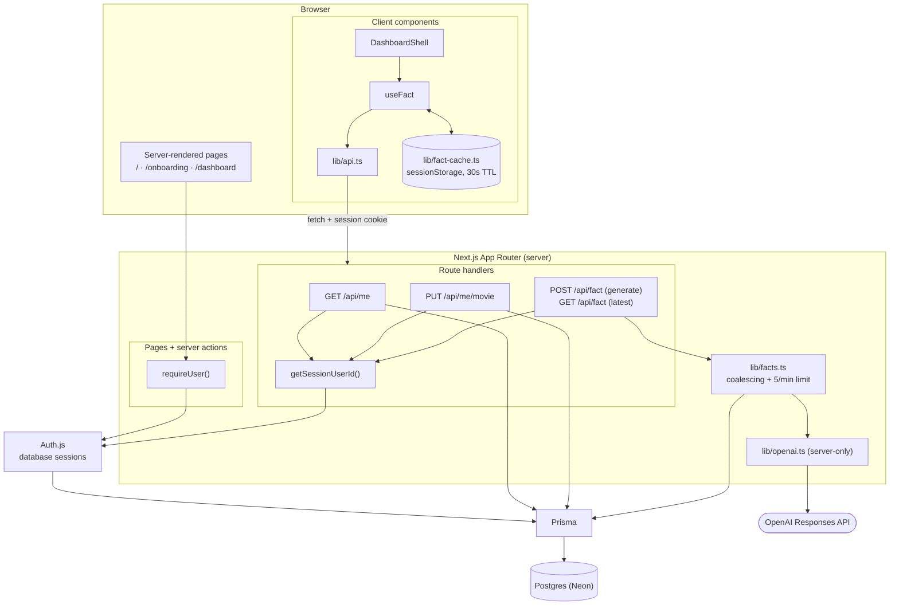

# Movie Memory

Sign in with Google, type in your favorite movie, and OpenAI will generate a fact about it for you!

**Stack:** Next.js 15 (App Router) · TypeScript · React 19 · Tailwind CSS 4 · Postgres · Prisma 6 · Auth.js v5 (Google) · OpenAI API

## How to use

1. **Sign in.** Visit `/` and click **Sign in with Google**.
2. **Onboarding (first time only).** If this is your first time visiting Movie Memory, you will be prompted to type your favorite movie in the text box. The title is trimmed and validated on the server (1–200 characters) and saved to your account. If there are multiple movies with the same title, you can add the year to clarify (e.g. Dune (1984) vs Dune (2021)).
3. **Dashboard.** Once you have typed your favorite movie, you will be directed to the dashboard. The dashboard shows your name, email and Google photo (or your initials if you don't have a profile picture), the movie that you typed, and a fun fact about it, generated by OpenAI. Returning users are automatically directed here.
   - **Edit your movie inline.** Click **Edit**, change the title, then **Save** (or Enter) or **Cancel** (or Escape). The new title appears immediately. If the save fails, it reverts and the editor reopens with your text and the error.
   - **Facts are cached for 30 seconds.** Refreshing the page within 30 seconds shows the same fact (marked "from cache"). Click **New fact** to always get a fresh one. Changing your movie discards the cached fact.
   - If OpenAI doesn't recognize the title you typed, the dashboard says so ("We couldn't find a movie called …") and shows a fact about a similar film instead, with a hint to check the spelling or add the year. Small typos and a missing year still count as recognized.
4. **Log out.** Click the button on the top-right of the dashboard to log out. Logging out also clears the cached fact.

## Setup

### Prerequisites

- Node.js 22.12+ (required by the `openai` SDK and Vitest; check with `node -v`)
- A Postgres database: a free [Neon](https://neon.tech) project, or a local one via the included `docker-compose.yml` (needs Docker Desktop or Colima running)
- A Google OAuth client
- An OpenAI API key

### 1. Install

```sh
npm install
```

### 2. Configure environment variables

```sh
cp .env.example .env
```

Here are the environment variables that you need to include in .env. Never share these with anyone or commit .env to source control.

| Variable                | Description                                                                                                                                          |
| ----------------------- | ---------------------------------------------------------------------------------------------------------------------------------------------------- |
| `DATABASE_URL`          | Postgres connection string the app uses at runtime. On Neon, use the **pooled** URL.                                                                 |
| `DATABASE_URL_UNPOOLED` | Direct connection string, used by `prisma migrate`. On Neon, use the **direct** URL. For local Postgres, set it to the same value as `DATABASE_URL`. |
| `AUTH_SECRET`           | Random secret for Auth.js. Generate with `openssl rand -base64 32`.                                                                                  |
| `AUTH_GOOGLE_ID`        | Google OAuth client ID.                                                                                                                              |
| `AUTH_GOOGLE_SECRET`    | Google OAuth client secret.                                                                                                                          |
| `OPENAI_API_KEY`        | OpenAI API key. Server-only, never sent to the browser.                                                                                              |
| `OPENAI_MODEL`          | Optional. Defaults to `gpt-6-luna`. Set `gpt-6.1-sol` for the larger model.                                                                          |

**Neon connection strings:** in the Neon console, open your project and click **Connect**. With **Connection pooling** on, the string is `DATABASE_URL`; with it off, the string is `DATABASE_URL_UNPOOLED`.

**Google OAuth setup:** in [Google Cloud Console](https://console.cloud.google.com/apis/credentials):

1. Configure the OAuth consent screen first (Google asks for it before it lets you create a client): choose **External**, fill in the app name and support email, and add your Google account as a **test user**. While the app is in "Testing" mode, only test users can sign in.
2. Create an OAuth client ID of type **Web application** with:
   - Authorized JavaScript origin: `http://localhost:3000`
   - Authorized redirect URI: `http://localhost:3000/api/auth/callback/google`
3. Copy the client ID and secret into `AUTH_GOOGLE_ID` and `AUTH_GOOGLE_SECRET`.

The default scopes (`openid`, `email`, `profile`) are all the app needs.

### 3. Set up the database

If you're using local Docker Postgres instead of Neon, start it first:

```sh
npm run db:up
```

Then apply the migrations:

```sh
npx prisma migrate deploy
```

This applies the committed migrations in `prisma/migrations/` and creates the tables. (The Prisma client was already generated by `npm install`.) To browse the data, run `npx prisma studio`.

Use `npx prisma migrate dev` (`npm run db:migrate`) only when you change `schema.prisma` and need to create a new migration. It needs a shadow database, and if the database has drifted from the migrations it offers to reset it, which deletes all data.

### 4. Run

```sh
npm run dev
```

Open http://localhost:3000. The app must run on port 3000, because that is the redirect URI registered with Google (see Troubleshooting).

## Scripts

| Command                       | What it does                                        |
| ----------------------------- | --------------------------------------------------- |
| `npm run dev`                 | Start the dev server                                |
| `npm run build` / `npm start` | Production build and start                          |
| `npm run lint`                | ESLint                                              |
| `npm run typecheck`           | TypeScript checks with no output files              |
| `npm test`                    | Run the unit and route tests (Vitest)               |
| `npm run test:e2e`            | Run the end-to-end test (Playwright, real database) |
| `npm run db:up`               | Start local Postgres (Docker)                       |
| `npm run db:migrate`          | Create a new migration after a schema change (`prisma migrate dev`) |

## Project structure

```
prisma/schema.prisma        Data model (User, Fact + Auth.js tables)
src/auth.ts                 Auth.js config (Google provider, Prisma adapter)
src/lib/session.ts          requireUser(): auth check used by every protected page/action
src/lib/auth-session.ts     getSession(): auth() that throws on a database outage instead of "signed out"
src/lib/validation.ts       Shared zod schema for movie titles
src/lib/openai.ts           Server-only OpenAI call
src/lib/facts.ts            Generates and stores facts
src/app/page.tsx            Landing page
src/app/error.tsx           Friendly error page for unexpected server errors
src/app/onboarding/
  page.tsx                  Server entry: auth, first-time-only redirect, passes the action to the form
  OnboardingForm.tsx        The form: input, counter, error and pending state
  actions.ts                Server action: validation and save
  types.ts                  Form state and action types
src/app/dashboard/
  page.tsx                  Server entry: auth, onboarding redirect, seeds the shell
  DashboardShell.tsx        The shell: state, API calls, validation, refresh, sign-out
  useFact.ts                Fact loading: cache, dedupe, stale-response protection
  types.ts                  Shell state types and component view models
  transforms.ts             Pure functions: API data → view models, draft validation
  components/               UI only: ProfileHeader, Avatar, FavoriteMovieEditor, FactCard
src/app/api/                Route handlers: /api/me, /api/me/movie, /api/fact
src/lib/api-contract.ts     Shared request/response schemas + error codes (server & client)
src/lib/api-server.ts       Server helpers: consistent JSON/error responses, session user id
src/lib/api.ts              Typed client: validates responses, normalizes errors to ApiError
src/lib/fact-cache.ts       30s client-side fact cache (sessionStorage)
src/lib/title-length.ts     toLengthHint(): character counter for title inputs
src/titlelength/            TitleLengthHint: counter display shared by both title inputs
src/types/                  Shared types (length hint, Auth.js session, CSS modules)
test/                       Vitest unit and route tests, mirroring src/
e2e/                        Playwright end-to-end test and a fake OpenAI server
docs/architecture.mmd       Architecture diagram (Mermaid)
```

## API

All endpoints act on the signed-in user (identified only by the session cookie) and return `Cache-Control: private, no-store`. Errors always have the shape `{ "error": { "code": "...", "message": "..." } }`.

| Endpoint | Success | Errors |
| --- | --- | --- |
| `GET /api/me` | `200 { user: { name, email, image, favoriteMovie } }` | `401 UNAUTHORIZED` |
| `PUT /api/me/movie` with body `{ movie }` | `200 { favoriteMovie }` (the trimmed, stored title) | `400 VALIDATION_ERROR`, `401` |
| `POST /api/fact` | `200 { fact: { id, movie, content, recognized, createdAt } }` (generates and stores a new fact) | `401`, `409 NO_FAVORITE_MOVIE`, `429 RATE_LIMITED` (with `Retry-After` for the app's own limit; not when OpenAI returns 429), `502 FACT_GENERATION_FAILED` |
| `GET /api/fact` | `200 { fact: { … } \| null }` (the latest stored fact about the current movie; no generation) | `401`, `409 NO_FAVORITE_MOVIE` |

## Variant chosen: B (Frontend/API-focused)

I chose Variant B because I have the most experience building frontend/API focused applications. The role also centers on building and consuming APIs and integrating with external services. This variant requires designing a clear REST contract, then consuming it through a typed client that validates every response at runtime and normalizes errors into a single shape.

## Architecture overview

### Request flow

Source: [docs/architecture.mmd](docs/architecture.mmd) (GitHub renders the copy below).



### Authentication and routing

- Auth.js v5 with the Google provider and the Prisma adapter. Sessions are database sessions: the cookie holds a token that is looked up in the `Session` table, so no user data lives in the cookie and sessions can be revoked on the server side.
- There is no middleware. Prisma cannot run on the edge runtime, so each protected page and server action calls `requireUser()`, and each route handler calls `getSessionUserId()`.
- Routing is decided on the server from one fact, whether `User.favoriteMovie` is null:
  - `/` redirects signed-in users to `/dashboard`; otherwise it shows "Sign in with Google".
  - `/dashboard` redirects to `/` when signed out, and to `/onboarding` when no movie is set.
  - `/onboarding` redirects to `/dashboard` once a movie is set, so it is first-time only.

### Data model

- **`User`**: the Auth.js fields (name, email, image, all nullable) plus `favoriteMovie`. A null `favoriteMovie` _is_ the "needs onboarding" signal, so there is no separate flag that could drift out of sync.
- **`Fact`**: `userId`, `movie`, `content`, `recognized`, `createdAt`. `recognized` is false when the model couldn't identify the title, so the UI can say the fact is about a similar film. `movie` is a snapshot of the title at generation time, so a fact about an old favorite is never mistaken for one about the current favorite. Facts cascade-delete with the user.
- **`Account`, `Session`, `VerificationToken`**: the standard Auth.js adapter tables.

### Validation and authorization

- One zod schema (`lib/validation.ts`) trims the title and enforces 1–200 characters. The onboarding server action and `PUT /api/me/movie` both use it; the client uses it too, but only as a UX shortcut. The inputs deliberately have no `maxLength`, which would silently stop typing or cut off a pasted title. Instead a character counter (`lib/title-length.ts`) appears within 40 characters of the limit and turns red past it, and submitting shows the validation message.
- The onboarding write is a conditional update (`WHERE favoriteMovie IS NULL`), so a replayed request or a second tab cannot overwrite an existing movie.
- Every query is scoped by the session's user id. Routes are `/api/me/...` with no id in the URL or body, so there is nothing for a caller to tamper with.

### API layer

- `lib/api-contract.ts` defines the response schemas, the request schema and the error codes, and is imported by both sides. Route handlers build responses of those types; the client parses responses against the same schemas.
- `lib/api-server.ts` gives every route the same JSON shapes and `Cache-Control: private, no-store`.
- `lib/api.ts` is the typed client. Every call either resolves with validated data or rejects with an `ApiError` carrying a normalized `code` and a user-safe message. Non-contract error bodies (for example a proxy's HTML 502), network failures and 2xx responses that break the contract are all mapped to codes, so UI code never inspects raw responses.

### Client state

- **Shell and components.** `DashboardShell` is the only part of the dashboard with state or I/O: it holds the state, calls the API client, validates the movie draft, and decides which state the fact card is in. The components in `dashboard/components/` are UI only: data comes in through props and events go out through callbacks, with no fetching, API client imports or business rules. Their only state is UI state: the avatar's fallback when the photo fails and focus handling. Pure functions in `transforms.ts` turn API data into the view models the components render (`toProfileView`, `toFactCardView`, `validateMovieDraft`, `toSaveFieldError`, `toLengthHint`), and the types live in `types.ts`. Onboarding follows this rule partly: the page passes the server action to the form as a prop and the action does the validation, but `OnboardingForm` still holds its own form state (the typed value, the server's error and the pending flag) rather than receiving it from a separate shell.
- `DashboardShell` owns `movie` (what is on screen), `isSaving` and the editor (open, draft, error). On save it shows the new title immediately, then either adopts the server's normalized value or reverts and reopens the editor with the user's text and the error.
- After a network error the outcome is ambiguous (the save may have landed), so it re-reads `GET /api/me` and adopts what the server actually has. A save counter stops a late reconciliation overwriting a newer edit.
- `useFact` is paused while a save is in flight, because `POST /api/fact` reads the movie from the database and could otherwise return a fact for the old title. It also:
  - checks the cache first unless the user clicked **New fact**;
  - shares one in-flight request per user and movie (covers double clicks and React StrictMode's double effect);
  - ignores responses that arrive after the movie changed or a newer request started;
  - refuses to cache a fact whose `movie` differs from the one on screen (changed in another tab).
- `lib/fact-cache.ts` keeps the single most recent fact in `sessionStorage` with the time it was cached. A lookup hits only if the user id and movie match and the entry is under 30 seconds old. It is cleared when the movie changes and on sign-out. Storage and clock are injected so the TTL logic is unit-tested without timers.

### Fact generation

- `lib/openai.ts` is `server-only` and reads `OPENAI_API_KEY` on the server, so the key cannot reach a client bundle.
- One call to the Responses API with a 15-second timeout and no automatic retries. The title is user input, so it is wrapped in delimiters and the instructions tell the model to treat it only as a title.
- The default model is `gpt-6-luna`, the cheaper tier: it knows 2026 releases such as _Hoppers_ and answers in about 3–5 seconds. `OPENAI_MODEL=gpt-6.1-sol` switches to the larger model.
- The reply uses Structured Outputs: JSON `{ recognized, fact }` checked by a schema. `recognized: false` means the model couldn't identify the title, so the fact is about a similarly named or related film; it is stored with the fact and the dashboard says so.
- `lib/facts.ts` guards cost on the server. Concurrent requests for the same user and movie share one OpenAI call, and each user gets at most 5 facts per minute, counted from their own `Fact` rows. A user's generations run one at a time, so each count includes the rows of the requests before it, even when the movie changes between requests; beyond the limit the route returns `429 RATE_LIMITED` with `Retry-After` and makes no OpenAI call.
- The user's last five stored facts about the same movie are sent with the prompt, and the model is asked for a different fact, so repeated clicks don't return rewordings.
- Any failure becomes a `FactGenerationError`. The route maps a rate limit to `429 RATE_LIMITED` and everything else (error, timeout, empty output) to `502 FACT_GENERATION_FAILED`, each with a friendly message. The UI shows the message with a **Try again** button and keeps any previous fact visible.

### Errors and security headers

- `src/app/error.tsx` catches unexpected server errors (a database outage, for example) and shows a friendly page with **Try again** and a reference code. Details go to the server logs, not the screen.
- Auth.js catches errors from the database session lookup and returns "no session", which on its own would turn an outage into a redirect to `/` or a `401`. `lib/auth-session.ts` wraps `auth()`: when there is no session but a session cookie was sent, it runs `SELECT 1`, and if that fails it rethrows. Pages then show `error.tsx` and the API answers `500 INTERNAL_ERROR`.
- `next.config.ts` sets headers on every response: a Content Security Policy that blocks framing, plugins and `<base>` hijacking, plus `X-Frame-Options: DENY`, `X-Content-Type-Options: nosniff`, `Referrer-Policy` and `Permissions-Policy`.
- If the Google profile photo fails to load, the avatar falls back to initials.

### Tests

`npm test` runs 97 Vitest tests in ten files. Tests live in `test/`, mirroring the `src/` layout (`test/lib/api.test.ts` tests `src/lib/api.ts`), with shared setup in `test/setup.ts`:

| File | Covers |
| --- | --- |
| `test/lib/api.test.ts` | Client success paths (including `POST` vs `GET` on `/api/fact`) and error normalization (401, 400, 500 non-JSON, network failure, invalid 2xx) |
| `test/lib/fact-cache.test.ts` | 30s TTL boundary, movie and user keying, invalidation, corrupt storage |
| `test/app/dashboard/transforms.test.ts` | Pure view-model functions: profile fallbacks and initials, draft validation, save-error mapping, every fact card state, the title-length counter |
| `test/app/dashboard/DashboardShell.test.tsx` | Profile header and sign-out; edit flow: optimistic update, revert on failure, cancel, validation, session expiry, network-error reconciliation, focus handling, cache reuse, the "couldn't find that movie" notice, the title-length counter and over-limit error |
| `test/lib/facts.test.ts` | Server throttle: concurrent requests share one call, per-user limit with `Retry-After`, the limit holding across concurrent requests for different movies, previous facts passed to the prompt |
| `test/lib/auth-session.test.ts` | `getSession()`: valid session, no cookie, invalid cookie with the database up, and a database outage rethrown |
| `test/lib/openai.test.ts` | Default model, Structured Outputs request, `recognized` flag, malformed or empty replies, OpenAI 429 |
| `test/app/api/fact/route.test.ts` | `GET` and `POST /api/fact`: 401, deleted user, 409; `GET` reads without generating; `POST` success shape, 429 (ours and OpenAI's), 502 |
| `test/app/api/me/route.test.ts` | `GET /api/me`: 401, deleted user, selected fields, `no-store` |
| `test/app/api/me/movie/route.test.ts` | `PUT /api/me/movie`: 401, validation, trimming, session-scoped write |

`npm run test:e2e` runs one Playwright test (`e2e/app-flow.spec.ts`) in Chromium against a real `next dev` server and the database in `DATABASE_URL`. It walks the whole flow: the sign-in button's OAuth redirect, the signed-out redirect, onboarding (including server-side rejection of a blank title, and the counter and error for an over-limit title), the dashboard profile and fact, the 30s cache on reload, the inline edit, and log out, checking the database at each step.

- **Google sign-in is not automated.** Google blocks automated logins, so the test checks that the app's button redirects to Google with the right client id and callback, then signs in the way the callback would: it creates a user and a database session and sets the session cookie.
- **OpenAI is faked.** The server calls OpenAI from Node, where Playwright can't intercept, so the test server gets `OPENAI_BASE_URL` pointing at `e2e/mock-openai.mjs` and a fake API key. No cost, and a misrouted call fails rather than billing.
- **Data:** each run creates a throwaway `@e2e.test` user and deletes it afterwards. Point `DATABASE_URL` at a Neon branch if you'd rather keep test rows off your main database.
- **Port 3000 must be free.** The test starts its own server and refuses to reuse a running `npm run dev`, which would call the real OpenAI. First run: `npx playwright install chromium`.

## Key tradeoffs

- **`/api/fact` is split into `GET` and `POST`.** The spec names `GET /api/fact`, but generating a fact stores a row and makes a paid OpenAI call, so it is neither safe nor idempotent, and browsers, prefetchers and crawlers are allowed to repeat a GET. Generation is therefore `POST /api/fact`, and `GET /api/fact` returns the latest stored fact without side effects. A POST also isn't sent with the session cookie from another site (`SameSite=Lax`), so a third-party page can't trigger it. On top of that, the client never refetches on its own, concurrent requests share one OpenAI call, and the server caps each user at 5 facts per minute. The dashboard doesn't use the `GET` yet.
- **A custom `useFact` hook rather than React Query or SWR.** The app has one cached resource with unusual rules: a fixed 30-second window keyed by user and movie, paused while a movie save is in flight, and never refetched automatically, because every fetch is a paid OpenAI call. A library would mean turning off most of its defaults (refetch on focus, retries, background revalidation) and still writing the movie keying and save-pause logic around it. A small hook plus a cache with an injected clock was simpler to reason about and to unit-test. If the app grew more server state, React Query would be the better choice.
- **The server throttle is per process.** Coalescing is an in-memory map, and the rate limit is made exact by running each user's generations one at a time in memory. With one instance the limit holds, even for a burst that changes the movie between requests. With several instances each process has its own queue, so a burst spread across them could exceed 5 per minute. A shared store (Redis, or a Postgres advisory lock) would close that gap but needs new infrastructure.
- **`sessionStorage` rather than in-memory cache.** It survives a page refresh, which an in-memory cache would not, and is cleared when the tab closes. The cost is that the cache is per tab.
- **`favoriteMovie` is a free-text column on `User`.** There is no `Movie` table or canonical movie id. This is the simplest model that meets the spec. However, movies are case sensitive, and you need the year for clarification.
- **Auth.js v5, which is still a beta.** I chose it for its mature Prisma adapter, first-class Next.js App Router support and documentation, and pinned the exact version (`5.0.0-beta.32`) so an install can't pull in a different beta. Auth.js is now maintained by the Better Auth team, which recommends Better Auth for new projects, so a longer-lived app should consider migrating.
- **The cheaper model, `gpt-6-luna`.** It knows recent films and is faster than `gpt-6.1-sol`, but in my testing its facts were occasionally less reliable. The prompt asks for plain text and accuracy, the per-user limit caps cost either way, and `OPENAI_MODEL` switches models without a code change.
- **Database sessions rather than JWTs.** Sessions are revocable and the cookie carries no data, at the price of a session lookup on every authenticated request.
- **Per-page auth checks rather than middleware.** Slightly repetitive, but it avoids running Prisma on the edge runtime and keeps the check next to the data access it protects.
- **No OpenAI retries.** A retry after a 15-second timeout would double the worst-case wait, and the user can ask again with one click.
- **The fact card is hidden while a movie save is in flight.** Showing the old fact under the new title would be misleading, so the card shows a short "saving" message instead.
- **Stored facts are mostly read by the server.** They drive the rate limit and the no-repeat prompt, and `GET /api/fact` exposes the latest one, but the UI shows only the fact it just generated.

## What I would improve with 2 more hours

- Store the rate limit in a shared store so that it survives between server instances.
- Make the Content Security Policy stricter with per-request script nonces (the current policy blocks framing, plugins and `<base>` hijacking, but doesn't yet restrict scripts).
- Display stored facts as a simple “previous facts” list and if the OpenAI call fails, fall back to the latest stored fact.
- When entering the title, check it against a movie database (TMDB based autocomplete) and store the movie's id and year. If the title is ambiguous or unknown it would be resolved before any facts appear. Also, case-sensitivity wouldn't apply.

## AI usage

- I used Claude to help structure the application architecture. I also used Claude to help me set up the project and give me directions on Prisma, Neon, OpenAI, and Google OAuth integration.
- I used Claude Code to help refine and test the application, as well as write Vitest and Playwright tests. I also used it to clean up the formatting of the application, including the README.

## Troubleshooting

- **`redirect_uri_mismatch` from Google:** the redirect URI in Google Cloud must be exactly `http://localhost:3000/api/auth/callback/google`. If port 3000 is already taken, `npm run dev` silently starts on 3001 and sign-in fails; stop whatever is using port 3000 (`lsof -i :3000`) and restart.
- **`Error 403: access_denied` from Google:** your account isn't a test user on the OAuth consent screen.
- **`npm run db:up` fails:** Docker must be running. If port 5432 is already in use, another Postgres is running locally; stop it, or point `DATABASE_URL` at it instead.
- **`EBADENGINE` warnings or test failures after `npm install`:** you're on an older Node. Use Node 22.12+.
- **"Couldn't generate a fact right now":** check `OPENAI_API_KEY` and your OpenAI billing. Accounts without a payment method have very low rate limits, as low as 3 requests per minute, and the dev server terminal shows the exact error.
- **Migrations hang or fail on Neon:** make sure `DATABASE_URL_UNPOOLED` is the direct (non-pooled) URL.
