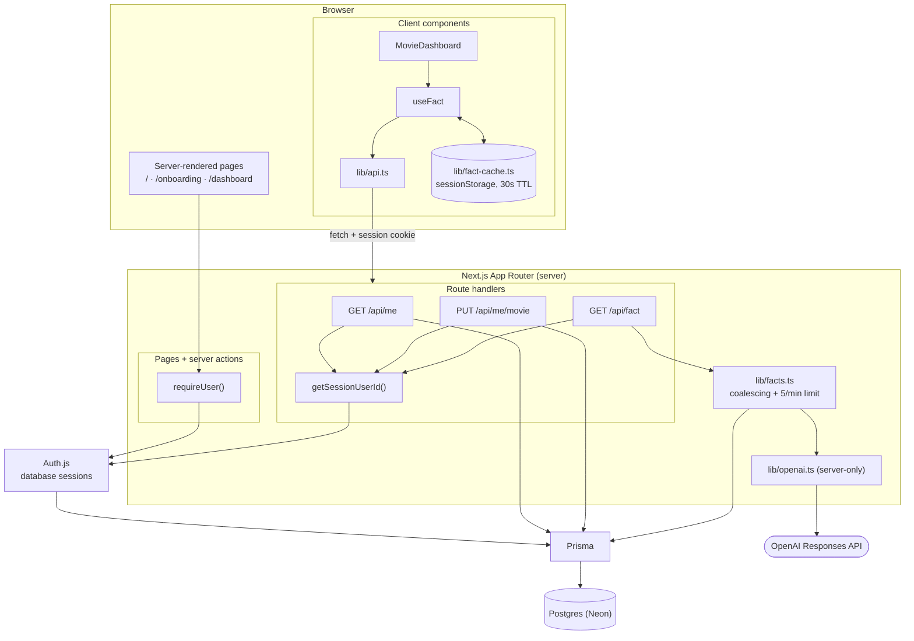

# Movie Memory

Sign in with Google, type in your favorite movie, and OpenAI will generate a fact about it for you!
**Stack:** Next.js 15 (App Router) · TypeScript · React 19 · Tailwind CSS 4 · Postgres · Prisma 6 · Auth.js v5 (Google) · OpenAI API

## How to use

1. **Sign in.** Visit `/` and click **Sign in with Google**.
2. **Onboarding (first time only).** If this is your first time visiting Movie Memory, you will be prompted to type your favorite movie in the text box. The title is trimmed and validated on the server (1–200 characters) and saved to your account. If there are multiple movies with the same title, you can add the year to clarify (e. g. Dune (1984) vs Dune (2021)).
3. **Dashboard.** Once you have typed your favorite movie, you will be directed to the dashboard. The dashboard shows your name, email and Google photo (or your initials if you don't have a profile picture), the movie that you typed, and a fun fact about it, generated by OpenAI. Returning users are automatically directed here.
   - **Edit your movie inline.** Click **Edit**, change the title, then **Save** (or Enter) or **Cancel** (or Escape). The new title appears immediately. If the save fails, it reverts and the editor reopens with your text and the error.
   - **Facts are cached for 30 seconds.** Refreshing the page within 30 seconds shows the same fact (marked "from cache"). Click **New fact** to always get a fresh one. Changing your movie discards the cached fact.
   - If OpenAI can't figure out the movie that you typed, it will fetch a fact for a similar movie or one from the same genre.
4. **Log out.** Click the button on the top-right of the dashboard to log out. Logging out also clears the cached fact.

## Setup

### Prerequisites

- Node.js 20+
- A Postgres database: a free [Neon](https://neon.tech) project, or a local one via the included `docker-compose.yml`
- A Google OAuth client
- An OpenAI API key

### 1. Install

```sh
npm install
```

### 2. Configure environment variables

```sh
cp .env.example .env
```

Here are the environment variables that you need to include in .env. Never share these with anyone or commit .env to source control.

| Variable                | Description                                                                                                                                          |
| ----------------------- | ---------------------------------------------------------------------------------------------------------------------------------------------------- |
| `DATABASE_URL`          | Postgres connection string the app uses at runtime. On Neon, use the **pooled** URL.                                                                 |
| `DATABASE_URL_UNPOOLED` | Direct connection string, used by `prisma migrate`. On Neon, use the **direct** URL. For local Postgres, set it to the same value as `DATABASE_URL`. |
| `AUTH_SECRET`           | Random secret for Auth.js. Generate with `openssl rand -base64 32`.                                                                                  |
| `AUTH_GOOGLE_ID`        | Google OAuth client ID.                                                                                                                              |
| `AUTH_GOOGLE_SECRET`    | Google OAuth client secret.                                                                                                                          |
| `OPENAI_API_KEY`        | OpenAI API key. Server-only, never sent to the browser.                                                                                              |
| `OPENAI_MODEL`          | Optional. Defaults to `gpt-6.1-sol`.                                                                                                                 |

**Google OAuth setup:** in [Google Cloud Console](https://console.cloud.google.com/apis/credentials), create an OAuth client ID of type **Web application** with:

- Authorized JavaScript origin: `http://localhost:3000`
- Authorized redirect URI: `http://localhost:3000/api/auth/callback/google`
  While the OAuth consent screen is in "Testing" mode, add your Google account as a test user.

### 3. Set up the database

If you're using local Docker Postgres instead of Neon, start it first:

```sh
npm run db:up
```

Then apply the migrations:

```sh
npx prisma migrate dev
```

This creates the tables and generates the Prisma client. To browse the data, run `npx prisma studio`.

### 4. Run

```sh
npm run dev
```

Open http://localhost:3000.

## Scripts

| Command                       | What it does                                       |
| ----------------------------- | -------------------------------------------------- |
| `npm run dev`                 | Start the dev server                               |
| `npm run build` / `npm start` | Production build and start                         |
| `npm run lint`                | ESLint                                             |
| `npm run typecheck`           | TypeScript checks with no output files             |
| `npm test`                    | Run the unit and route tests (Vitest)              |
| `npm run test:e2e`            | Run the end-to-end test (Playwright, real database) |
| `npm run db:up`               | Start local Postgres (Docker)                      |
| `npm run db:migrate`          | Create and apply migrations (`prisma migrate dev`) |

## Project structure

```
prisma/schema.prisma        Data model (User, Fact + Auth.js tables)
src/auth.ts                 Auth.js config (Google provider, Prisma adapter)
src/lib/session.ts          requireUser(): auth check used by every protected page/action
src/lib/validation.ts       Shared zod schema for movie titles
src/lib/openai.ts           Server-only OpenAI call
src/lib/facts.ts            Generates and stores facts
src/app/page.tsx            Landing page
src/app/onboarding/         Favorite-movie form + server action
src/app/dashboard/          Dashboard: server page + client MovieDashboard, editor, fact card
src/app/api/                Route handlers: /api/me, /api/me/movie, /api/fact
src/lib/api-contract.ts     Shared request/response schemas + error codes (server & client)
src/lib/api-server.ts       Server helpers: consistent JSON/error responses, session user id
src/lib/api.ts              Typed client: validates responses, normalizes errors to ApiError
src/lib/fact-cache.ts       30s client-side fact cache (sessionStorage)
src/hooks/useFact.ts        Fact loading: cache, dedupe, stale-response protection
```

## API

All endpoints act on the signed-in user (identified only by the session cookie) and return `Cache-Control: private, no-store`. Errors always have the shape `{ "error": { "code": "...", "message": "..." } }`.
| Endpoint | Success | Errors |
| --- | --- | --- |
| `GET /api/me` | `200 { user: { name, email, image, favoriteMovie } }` | `401 UNAUTHORIZED` |
| `PUT /api/me/movie` with body `{ movie }` | `200 { favoriteMovie }` (the trimmed, stored title) | `400 VALIDATION_ERROR`, `401` |
| `GET /api/fact` | `200 { fact: { id, movie, content, createdAt } }` (generates and stores a new fact) | `401`, `409 NO_FAVORITE_MOVIE`, `429 RATE_LIMITED`, `502 FACT_GENERATION_FAILED` |

## Variant chosen: B (Frontend/API-focused)

I chose Variant B because I have the most experience building frontend/API focused applications. The role also centers on building and consuming APIs and integrating with external services. This variant requires designing a clear REST contract, then consuming it through a typed client that validates every response at runtime and normalizes errors into a single shape.

## Architecture overview

### Request flow

Source: [docs/architecture.mmd](docs/architecture.mmd) (GitHub renders the copy below).



### Authentication and routing

- Auth.js v5 with the Google provider and the Prisma adapter. Sessions are **database sessions**: the cookie holds an opaque token that is looked up in the `Session` table, so no user data lives in the cookie and sessions can be revoked server-side.
- There is no middleware. Prisma cannot run on the edge runtime, so each protected page and server action calls `requireUser()`, and each route handler calls `getSessionUserId()`.
- Routing is decided on the server from one fact, whether `User.favoriteMovie` is null:
  - `/` redirects signed-in users to `/dashboard`; otherwise it shows "Sign in with Google".
  - `/dashboard` redirects to `/` when signed out, and to `/onboarding` when no movie is set.
  - `/onboarding` redirects to `/dashboard` once a movie is set, so it is first-time only.

### Data model

- **`User`**: the Auth.js fields (name, email, image, all nullable) plus `favoriteMovie`. A null `favoriteMovie` _is_ the "needs onboarding" signal, so there is no separate flag that could drift out of sync.
- **`Fact`**: `userId`, `movie`, `content`, `createdAt`. `movie` is a snapshot of the title at generation time, so a fact about an old favorite is never mistaken for one about the current favorite. Facts cascade-delete with the user.
- **`Account`, `Session`, `VerificationToken`**: the standard Auth.js adapter tables.

### Validation and authorization

- One zod schema (`lib/validation.ts`) trims the title and enforces 1–200 characters. The onboarding server action and `PUT /api/me/movie` both use it; the client uses it too, but only as a UX shortcut.
- The onboarding write is a conditional update (`WHERE favoriteMovie IS NULL`), so a replayed request or a second tab cannot overwrite an existing movie.
- Every query is scoped by the session's user id. Routes are `/api/me/...` with no id in the URL or body, so there is nothing for a caller to tamper with.

### API layer

- `lib/api-contract.ts` defines the response schemas, the request schema and the error codes, and is imported by both sides. Route handlers build responses of those types; the client parses responses against the same schemas.
- `lib/api-server.ts` gives every route the same JSON shapes and `Cache-Control: private, no-store`.
- `lib/api.ts` is the typed client. Every call either resolves with validated data or rejects with an `ApiError` carrying a normalized `code` and a user-safe message. Non-contract error bodies (for example a proxy's HTML 502), network failures and 2xx responses that break the contract are all mapped to codes, so UI code never inspects raw responses.

### Client state

- `MovieDashboard` owns `movie` (what is on screen) and `isSaving`. On save it shows the new title immediately, then either adopts the server's normalized value or reverts and reopens the editor with the user's text and the error.
- After a network error the outcome is ambiguous (the save may have landed), so it re-reads `GET /api/me` and adopts what the server actually has. A save counter stops a late reconciliation overwriting a newer edit.
- `useFact` is paused while a save is in flight, because `GET /api/fact` reads the movie from the database and could otherwise return a fact for the old title. It also:
  - checks the cache first unless the user clicked **New fact**;
  - shares one in-flight request per user and movie (covers double clicks and React StrictMode's double effect);
  - ignores responses that arrive after the movie changed or a newer request started;
  - refuses to cache a fact whose `movie` differs from the one on screen (changed in another tab).
- `lib/fact-cache.ts` keeps the single most recent fact in `sessionStorage` with the time it was cached. A lookup hits only if the user id and movie match and the entry is under 30 seconds old. It is cleared when the movie changes and on sign-out. Storage and clock are injected so the TTL logic is unit-tested without timers.

### Fact generation

- `lib/openai.ts` is `server-only` and reads `OPENAI_API_KEY` on the server, so the key cannot reach a client bundle.
- One call to the Responses API with a 15-second timeout and no automatic retries. The title is user input, so it is wrapped in delimiters and the instructions tell the model to treat it only as a title.
- `lib/facts.ts` guards cost on the server. Concurrent requests for the same user and movie share one OpenAI call, and each user gets at most 5 facts per minute, counted from their own `Fact` rows; beyond that the route returns `429 RATE_LIMITED` with `Retry-After` and makes no OpenAI call.
- The user's last 5 stored facts about the same movie are sent with the prompt, and the model is asked for a different fact, so repeated clicks don't return rewordings.
- Any failure becomes a `FactGenerationError`. The route maps a rate limit to `429 RATE_LIMITED` and everything else (error, timeout, empty output) to `502 FACT_GENERATION_FAILED`, each with a friendly message. The UI shows the message with a **Try again** button and keeps any previous fact visible.

### Errors and security headers

- `src/app/error.tsx` catches unexpected server errors (a database outage, for example) and shows a friendly page with **Try again** and a reference code. Details go to the server logs, not the screen.
- `next.config.ts` sets headers on every response: a Content Security Policy that blocks framing, plugins and `<base>` hijacking, plus `X-Frame-Options: DENY`, `X-Content-Type-Options: nosniff`, `Referrer-Policy` and `Permissions-Policy`.
- If the Google profile photo fails to load, the avatar falls back to initials.

### Tests

`npm test` runs 48 Vitest tests in seven files:
| File | Covers |
| --- | --- |
| `src/lib/api.test.ts` | Client success paths and error normalization (401, 400, 500 non-JSON, network failure, invalid 2xx) |
| `src/lib/fact-cache.test.ts` | 30s TTL boundary, movie and user keying, invalidation, corrupt storage |
| `src/app/dashboard/MovieDashboard.test.tsx` | Edit flow: optimistic update, revert on failure, cancel, validation, session expiry, network-error reconciliation, focus handling, cache reuse |
| `src/lib/facts.test.ts` | Server throttle: concurrent requests share one call, per-user limit with `Retry-After`, previous facts passed to the prompt |
| `src/app/api/fact/route.test.ts` | `GET /api/fact`: 401, 409, success shape, 429 (ours and OpenAI's), 502 |
| `src/app/api/me/route.test.ts` | `GET /api/me`: 401, deleted user, selected fields, `no-store` |
| `src/app/api/me/movie/route.test.ts` | `PUT /api/me/movie`: 401, validation, trimming, session-scoped write |

`npm run test:e2e` runs one Playwright test (`e2e/app-flow.spec.ts`) in Chromium against a real `next dev` server and the database in `DATABASE_URL`. It walks the whole flow: the sign-in button's OAuth redirect, the signed-out redirect, onboarding (including server-side rejection of a blank title), the dashboard profile and fact, the 30s cache on reload, the inline edit, and log out, checking the database at each step.

- **Google sign-in is not automated.** Google blocks automated logins, so the test checks that our button redirects to Google with the right client id and callback, then signs in the way the callback would: it creates a user and a database session and sets the session cookie.
- **OpenAI is faked.** The server calls OpenAI from Node, where Playwright can't intercept, so the test server gets `OPENAI_BASE_URL` pointing at `e2e/mock-openai.mjs` and a fake API key. No cost, and a misrouted call fails rather than billing.
- **Data:** each run creates a throwaway `@e2e.test` user and deletes it afterwards. Point `DATABASE_URL` at a Neon branch if you'd rather keep test rows off your main database.
- **Port 3000 must be free.** The test starts its own server and refuses to reuse a running `npm run dev`, which would call the real OpenAI. First run: `npx playwright install chromium`.

## Key tradeoffs

- **`GET /api/fact` generates and stores a new fact on every call.** This matches the endpoint named in the spec and keeps caching entirely on the client, which is Variant B's focus. The cost is a GET with side effects: it is not idempotent, and a `POST` would be the more correct verb.
- **The server throttle is per process.** Coalescing is an in-memory map and the rate limit is read-then-write, so with several server instances a burst could slightly exceed 5 per minute. A shared store (Redis, or a Postgres advisory lock) would make it exact; for one instance it is exact enough and needs no new infrastructure.
- **`sessionStorage` rather than in-memory cache.** It survives a page refresh, which an in-memory cache would not, and is cleared when the tab closes. The cost is that the cache is per tab.
- **`favoriteMovie` is a free-text column on `User`.** There is no `Movie` table or canonical movie id. This is the simplest model that meets the spec; the cost is that "Heat" and "heat" are different movies, and same-titled films need the year typed in.
- **Database sessions rather than JWTs.** Sessions are revocable and the cookie carries no data, at the price of a session lookup on every authenticated request.
- **Per-page auth checks rather than middleware.** Slightly repetitive, but it avoids running Prisma on the edge runtime and keeps the check next to the data access it protects.
- **No OpenAI retries.** A retry after a 15-second timeout would double the worst-case wait, and the user can ask again with one click.
- **The fact card is hidden while a movie save is in flight.** Showing the old fact under the new title would be misleading, so the card shows a short "saving" message instead.
- **Stored facts are read back only by the server.** They drive the rate limit and the no-repeat prompt, but the UI shows only the latest fact.

## What I would improve with 2 more hours

- Move the rate limit to a shared store so it holds across server instances.
- Tighten the Content Security Policy with per-request script nonces (the current policy covers framing, plugins and `<base>`, not scripts).
- Surface the stored facts as a small "previous facts" history, and fall back to the most recent stored fact when OpenAI fails.
- Run the end-to-end test in CI against a fresh Neon branch per pull request.
- Add a database-level length constraint on `favoriteMovie` to back up the application validation.
- Make the default model a cheaper tier, since a one-line fun fact does not need a frontier model.

## AI usage

<!-- TODO: replace these placeholders with how you actually used AI tools. The exercise asks for a short bulleted note. -->

- _TODO: which tools were used (for example Claude, Copilot) and for what (scaffolding, tests, review, docs)._
- _TODO: what was written or decided by hand, and how AI-generated code was reviewed and verified._

## Troubleshooting

- **`redirect_uri_mismatch` from Google:** the redirect URI in Google Cloud must be exactly `http://localhost:3000/api/auth/callback/google`.
- **"Couldn't generate a fact right now":** check `OPENAI_API_KEY` and your OpenAI billing. Accounts without a payment method have very low rate limits, as low as 3 requests per minute, and the dev server terminal shows the exact error.
- **Migrations hang or fail on Neon:** make sure `DATABASE_URL_UNPOOLED` is the direct (non-pooled) URL.
